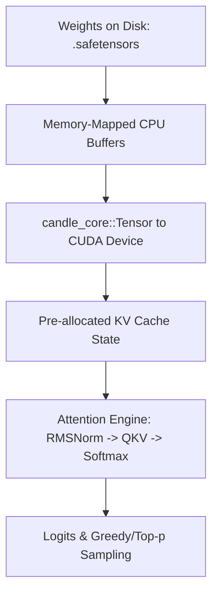

# Candle Learning Path - Structured Tutorial

This directory mirrors the same module style used across this repository:
- numbered modules
- per-module `README.md`
- `exercises/*_FILL_IN.rs` (you complete)
- `exercises/*.rs` (reference implementation)
- capstone projects

## Learning Order

1. `Module_01_Tensor_Fundamentals`
2. `Module_02_Autograd_and_Optimization`
3. `Module_03_Building_NN_Blocks`
4. `Module_04_Transformer_and_KV_Cache`
5. `Module_05_Quantization`
6. `Module_06_CUDA_and_Tensor_Cores`
7. `Module_07_Profiling_and_Optimization`
8. `Module_08_Model_Loading_and_Inference`
9. `Projects/01_tiny_transformer`
10. `Projects/02_perf_tuned_decode`

## Directory Structure

```text
Candle/
├── README.md
├── tools/
│   └── bootstrap_candle_lab.sh
├── Module_01_Tensor_Fundamentals/
├── Module_02_Autograd_and_Optimization/
├── Module_03_Building_NN_Blocks/
├── Module_04_Transformer_and_KV_Cache/
├── Module_05_Quantization/
├── Module_06_CUDA_and_Tensor_Cores/
├── Module_07_Profiling_and_Optimization/
├── Module_08_Model_Loading_and_Inference/
└── Projects/
    ├── 01_tiny_transformer/
    └── 02_perf_tuned_decode/
```

## Quickstart

```bash
cd Candle
cd candle_lab
./run_solution.sh module_01_tensor_fundamentals__ex01_tensor_basics
```

`Candle/candle_lab` is preloaded with all module/project bins.

- `BIN_LIST_ALL.txt`: all bins (`*_fill_in` + solutions)
- `BIN_LIST_SOLUTIONS.txt`: runnable reference bins only

To regenerate `candle_lab` from module files:

```bash
cd Candle
rm -rf candle_lab
./tools/bootstrap_candle_lab.sh
```


---

## Educational & Memory Flow Architecture

### 1. Memory Hierarchy & Dataflow Architecture
```text
+---------------------------------------------------------------------------------+
| CPU Host RAM (Rust Vec / Tensor Buffers / Safetensors Mmap)                     |
+---------------------------------------------------------------------------------+
        |  candle_core::Tensor::to_device(&Device::Cuda(0)) ^
        v                                                   |
+---------------------------------------------------------------------------------+
| GPU Device Memory (Safetensors Weights / KV-Cache Buffer)                        |
+---------------------------------------------------------------------------------+
        |  Vectorized Cuda Kernels                          ^
        v                                                   |
+---------------------------------------------------------------------------------+
| CUDA Cores / Tensor Cores (GEMM, RMSNorm, Softmax)                              |
+---------------------------------------------------------------------------------+
```

### 2. Execution & Dataflow Graph


### 3. Modern Candle Rust ML Architecture & Acceleration
- **Zero-Copy Views:** Tensor slicing using `tensor.narrow(...)`, `.transpose(...)`, and `.contiguous()` without unintended memory copies.
- **Device Placement:** Dynamic GPU backend detection with `Device::cuda_if_available(0)` and Tensor Core GEMM fallback.
- **Pre-allocated KV Cache:** State retention structures minimizing dynamic heap allocations during autoregressive generation loops.
- **Quantized Kernel Support:** Native parsing and hardware execution of GGUF/GGML quantized tensor weights (`Q4_K_M`, `Q8_0`).

### 4. Mathematical & Architectural Key Principles
- **Arithmetic Intensity & Roofline Model:** Bound kernel efficiency by maximizing FLOPS per byte transferred from higher-latency memory tiers:
  $$\text{Operational Intensity} = \frac{\text{Floating Point Operations (FLOPs)}}{\text{Bytes Transferred (DRAM \leftrightarrow SRAM)}}$$
- **Latency Hiding:** Software pipelines overlap asynchronous global loads with compute stages across unrolled loops.
- **Memory Coalescing & Bank Alignment:** Aligned memory accesses ensure full 32-byte or 128-byte transactions, preventing pipeline stalls.

---
