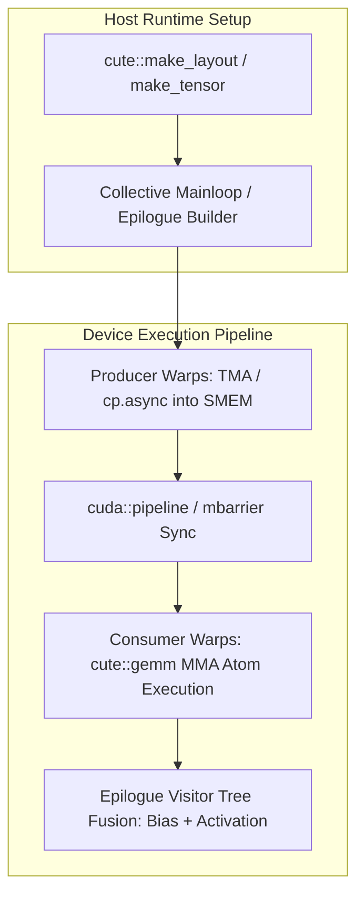

# CuTile Tutorial: Learn GPU Programming the Fill-Code Way

Welcome to the **CuTile Tutorial**! This interactive, modular course will teach you everything you need to know about NVIDIA CuTile Python, a tile-based GPU programming model that unlocks peak GPU performance with Tensor Cores.

## 🎯 What You'll Learn

By completing this tutorial, you'll master:
- **GPU Programming Fundamentals** - Understand the tile-based programming model
- **CuTile Data Model** - Arrays, tiles, memory layouts, and strides
- **Kernel Development** - Write, launch, and optimize GPU kernels
- **Tensor Core Programming** - Leverage matrix multiply-accumulate operations
- **Advanced Techniques** - Persistent kernels, swizzling, and performance optimization

## 📚 Tutorial Structure

This tutorial uses a **fill-in-the-code** style. Each module contains:
- `README.md` - Concept explanation and theory
- `kernel.py` - Code with `# FILL IN:` comments for you to complete
- `solution.py` - Complete working solution (check after trying!)
- `test.py` - Test your implementation

### Module List

| Module | Topic | Description |
|--------|-------|-------------|
| [00_setup](./00_setup/) | **Setup & First Kernel** | Installation, prerequisites, your first GPU kernel |
| [01_data_model](./01_data_model/) | **Arrays & Tiles** | Global arrays, tile data structures, memory layouts |
| [02_kernel_basics](./02_kernel_basics/) | **Kernel Fundamentals** | `@kernel` decorator, `ct.launch()`, block IDs |
| [03_load_store](./03_load_store/) | **Memory Operations** | `ct.load()`, `ct.store()`, data movement patterns |
| [04_tile_operations](./04_tile_operations/) | **Tile Arithmetic** | Element-wise ops, broadcasting, shape manipulation |
| [05_matrix_operations](./05_matrix_operations/) | **Matrix Multiply** | `ct.matmul()`, `ct.mma()`, Tensor Core acceleration |
| [06_advanced_tiling](./06_advanced_tiling/) | **2D/3D Grids** | Multi-dimensional grids, swizzling, memory coalescing |
| [07_reductions_atomics](./07_reductions_atomics/) | **Reductions & Atomics** | `ct.sum()`, `ct.max()`, atomic operations |
| [08_persistent_kernels](./08_persistent_kernels/) | **Persistent Kernels** | Optimization techniques, persistent kernel patterns |
| [09_capstone](./09_capstone/) | **Capstone Project** | Build a fused multi-head attention kernel |

## 🚀 How to Use This Tutorial

### Step 1: Start Sequentially
Begin with **Module 00** and work through each module in order. Concepts build upon each other.

### Step 2: Read the Concepts
Each module's `README.md` explains the theory and provides examples.

### Step 3: Fill in the Code
Open `kernel.py` and complete the sections marked with:
```python
# FILL IN: Your code here
```

### Step 4: Test Your Solution
Run the test file to verify your implementation:
```bash
python test.py
```

### Step 5: Compare with Solution
Check `solution.py` to see the reference implementation and compare approaches.

## 📋 Prerequisites

Before starting, ensure you have:
- **Python 3.10+** installed
- **CUDA Toolkit 13.1+** installed
- **NVIDIA Driver r580+** (for Blackwell/Ampere/Ada GPUs)
- Basic knowledge of Python programming
- Familiarity with linear algebra (matrix operations)

## 🔧 Installation

```bash
# Install CuTile Python
pip install cuda-tile

# Install additional dependencies for examples
pip install torch cupy-cuda13x numpy
```

## 💡 Tips for Success

1. **Don't peek at solutions too early!** Struggle with the problems first.
2. **Read error messages carefully** - CuTile provides helpful compile-time errors.
3. **Experiment** - Modify tile sizes and observe performance changes.
4. **Think in tiles** - Visualize how data is partitioned across GPU blocks.
5. **Use the documentation** - Keep [CuTile docs](https://docs.nvidia.com/cuda/cutile-python/) open.

## 📖 Additional Resources

- [Official CuTile Documentation](https://docs.nvidia.com/cuda/cutile-python/)
- [CuTile Python GitHub](https://github.com/NVIDIA/cutile-python)
- [TileGym Repository](https://github.com/NVIDIA/TileGym) - More examples
- [NVIDIA Developer Blog: Matrix Multiply in CUDA Tile](https://developer.nvidia.com/blog/how-to-write-high-performance-matrix-multiply-in-nvidia-cuda-tile/)

## 🎓 Learning Path

```
Beginner → Modules 00-03: Fundamentals
   ↓
Intermediate → Modules 04-06: Operations & Tiling
   ↓
Advanced → Modules 07-08: Optimization
   ↓
Expert → Module 09: Capstone Project
```

---

**Ready to start?** Head over to [Module 00: Setup & First Kernel](./00_setup/) and begin your CuTile journey!


---

## Educational & Memory Flow Architecture

### 1. Memory Hierarchy & Dataflow Architecture
```text
+---------------------------------------------------------------------------------+
| Global Memory (TMA Multicast / cp.async)                                        |
+---------------------------------------------------------------------------------+
        |  Async TMA Load Descriptor                       ^  TMA Store / Epilogue
        v                                                  |
+---------------------------------------------------------------------------------+
| Shared Memory (CuTE Swizzled Layout to eliminate 32-bank conflicts)             |
| Multi-stage Circular Buffer Managed by cute::PipelineTmaAsync                   |
+---------------------------------------------------------------------------------+
        |  cute::copy(tiled_copy, sA, rA)                  ^  cute::copy(rC, sC)
        v                                                  |
+---------------------------------------------------------------------------------+
| Tensor Core MMA Registers (cute::gemm(tiled_mma, rA, rB, accum))                |
+---------------------------------------------------------------------------------+
```

### 2. Execution & Dataflow Graph


### 3. Modern CUTLASS 3.x / 4.x & CuTE Layout Algebra Architecture
- **CuTE Layout Hierarchy:** Composable multidimensional mapping: `auto layout = make_layout(make_shape(M, N), make_stride(StrideM, StrideN));` with support for hierarchical tiling and compile-time shape deduction.
- **Collective Builders:** Modern collective mainloop construction: `cutlass::gemm::collective::CollectiveBuilder<Arch, Operator, ElementA, LayoutA, ElementB, LayoutB, ElementAccumulator, TileShape, ClusterShape, StageCount, KernelSchedule>::CollectiveOp`.
- **Warp Specialization & TMA Support:** Asynchronous copy via Tensor Memory Accelerator (TMA) bypassing register files and feeding SMEM directly, synchronized with `cute::PipelineTmaAsync` and `cuda::barrier`.
- **Epilogue Visitor Tree (EVT):** Direct in-register fusion of bias, activation (GELU, ReLU, Silu), and quantization scaling before writing back to global memory.

### 4. Mathematical & Architectural Key Principles
- **Arithmetic Intensity & Roofline Model:** Bound kernel efficiency by maximizing FLOPS per byte transferred from higher-latency memory tiers:
  $$\text{Operational Intensity} = \frac{\text{Floating Point Operations (FLOPs)}}{\text{Bytes Transferred (DRAM \leftrightarrow SRAM)}}$$
- **Latency Hiding:** Software pipelines overlap asynchronous global loads with compute stages across unrolled loops.
- **Memory Coalescing & Bank Alignment:** Aligned memory accesses ensure full 32-byte or 128-byte transactions, preventing pipeline stalls.

---
