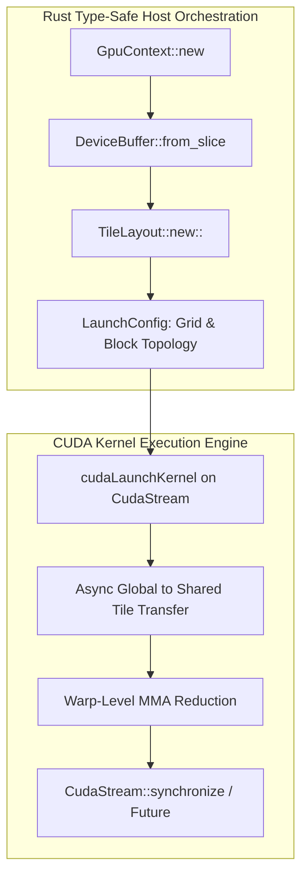

# CuTile-RS Tutorial

This tutorial is a fill-in-the-code path for learning CuTile Rust from memory fundamentals to Tensor Core-oriented kernels.

## Learning Flow

1. Read module `README.md`.
2. Implement `kernel.rs` by replacing `// FILL IN` sections.
3. Run tests from the module directory.
4. Compare against `solution.rs`.

Use reference solutions in tests:

```bash
TUTORIAL_USE_SOLUTION=1 rustc --test test.rs -o test_bin && ./test_bin
```

## Modules

- `00_setup`
- `01_data_model`
- `02_kernel_basics`
- `03_load_store`
- `04_tile_operations`
- `05_matrix_operations`
- `06_advanced_tiling`
- `07_reductions_atomics`
- `08_persistent_kernels`
- `09_capstone`


---

## Educational & Memory Flow Architecture

### 1. Memory Hierarchy & Dataflow Architecture
```text
+---------------------------------------------------------------------------------+
| Host Memory (Rust GpuBuffer / Pinned Device Slice)                              |
+---------------------------------------------------------------------------------+
        |  Zero-Copy Async Stream Transfer / HBM Upload    ^  DeviceToHost Stream
        v                                                  |
+---------------------------------------------------------------------------------+
| Device Global Memory (DeviceBuffer<T> / Shape<M, N>)                             |
+---------------------------------------------------------------------------------+
        |  Type-Safe Tile Slicing: TileView<'a, T>         ^  Tiled Store
        v                                                  |
+---------------------------------------------------------------------------------+
| Shared Memory Scratchpad (Static Alloc / Bank-Conflict Free Strided Layout)      |
+---------------------------------------------------------------------------------+
        |  Tensor Core MMA Kernel Execution / SIMD Vector   ^
        v                                                  |
+---------------------------------------------------------------------------------+
| Hardware Registers & Tensor Core Execution Units                                 |
+---------------------------------------------------------------------------------+
```

### 2. Execution & Dataflow Graph


### 3. Cutile-RS Architectural Principles & Type Safety
- **Rust Memory Safety for CUDA:** Compile-time verification of buffer lifetimes (`'a`) and non-aliasing guarantees across concurrent CUDA streams.
- **Const-Generic Tile Geometry:** Shapes and strides encoded as const generics (`Tile<T, M, N>`) allowing compile-time calculation of shared memory requirements.
- **Zero-Cost Abstractions:** Direct inlining into raw CUDA Driver/Runtime FFI without runtime penalty or allocation overhead.
- **Async/Await Stream Integration:** Integration with Tokio / async runtimes using non-blocking CUDA event queries.

### 4. Mathematical & Architectural Key Principles
- **Arithmetic Intensity & Roofline Model:** Bound kernel efficiency by maximizing FLOPS per byte transferred from higher-latency memory tiers:
  $$\text{Operational Intensity} = \frac{\text{Floating Point Operations (FLOPs)}}{\text{Bytes Transferred (DRAM \leftrightarrow SRAM)}}$$
- **Latency Hiding:** Software pipelines overlap asynchronous global loads with compute stages across unrolled loops.
- **Memory Coalescing & Bank Alignment:** Aligned memory accesses ensure full 32-byte or 128-byte transactions, preventing pipeline stalls.

---
