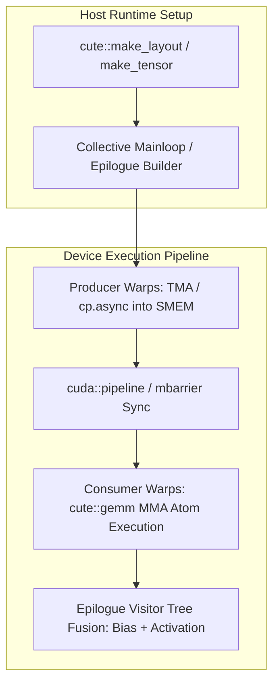

# CuTile-RS Tutorial

This tutorial is a fill-in-the-code path for learning CuTile Rust from memory fundamentals to Tensor Core-oriented kernels.

## Learning Flow

1. Read module `README.md`.
2. Implement `kernel.rs` by replacing `// FILL IN` sections.
3. Run tests from the module directory.
4. Compare against `solution.rs`.

Use reference solutions in tests:

```bash
TUTORIAL_USE_SOLUTION=1 rustc --test test.rs -o test_bin && ./test_bin
```

## Modules

- `00_setup`
- `01_data_model`
- `02_kernel_basics`
- `03_load_store`
- `04_tile_operations`
- `05_matrix_operations`
- `06_advanced_tiling`
- `07_reductions_atomics`
- `08_persistent_kernels`
- `09_capstone`


---

## Educational & Memory Flow Architecture

### 1. Memory Hierarchy & Dataflow Architecture
```text
+---------------------------------------------------------------------------------+
| Global Memory (TMA Multicast / cp.async)                                        |
+---------------------------------------------------------------------------------+
        |  Async TMA Load Descriptor                       ^  TMA Store / Epilogue
        v                                                  |
+---------------------------------------------------------------------------------+
| Shared Memory (CuTE Swizzled Layout to eliminate 32-bank conflicts)             |
| Multi-stage Circular Buffer Managed by cute::PipelineTmaAsync                   |
+---------------------------------------------------------------------------------+
        |  cute::copy(tiled_copy, sA, rA)                  ^  cute::copy(rC, sC)
        v                                                  |
+---------------------------------------------------------------------------------+
| Tensor Core MMA Registers (cute::gemm(tiled_mma, rA, rB, accum))                |
+---------------------------------------------------------------------------------+
```

### 2. Execution & Dataflow Graph


### 3. Modern CUTLASS 3.x / 4.x & CuTE Layout Algebra Architecture
- **CuTE Layout Hierarchy:** Composable multidimensional mapping: `auto layout = make_layout(make_shape(M, N), make_stride(StrideM, StrideN));` with support for hierarchical tiling and compile-time shape deduction.
- **Collective Builders:** Modern collective mainloop construction: `cutlass::gemm::collective::CollectiveBuilder<Arch, Operator, ElementA, LayoutA, ElementB, LayoutB, ElementAccumulator, TileShape, ClusterShape, StageCount, KernelSchedule>::CollectiveOp`.
- **Warp Specialization & TMA Support:** Asynchronous copy via Tensor Memory Accelerator (TMA) bypassing register files and feeding SMEM directly, synchronized with `cute::PipelineTmaAsync` and `cuda::barrier`.
- **Epilogue Visitor Tree (EVT):** Direct in-register fusion of bias, activation (GELU, ReLU, Silu), and quantization scaling before writing back to global memory.

### 4. Mathematical & Architectural Key Principles
- **Arithmetic Intensity & Roofline Model:** Bound kernel efficiency by maximizing FLOPS per byte transferred from higher-latency memory tiers:
  $$\text{Operational Intensity} = \frac{\text{Floating Point Operations (FLOPs)}}{\text{Bytes Transferred (DRAM \leftrightarrow SRAM)}}$$
- **Latency Hiding:** Software pipelines overlap asynchronous global loads with compute stages across unrolled loops.
- **Memory Coalescing & Bank Alignment:** Aligned memory accesses ensure full 32-byte or 128-byte transactions, preventing pipeline stalls.

---
