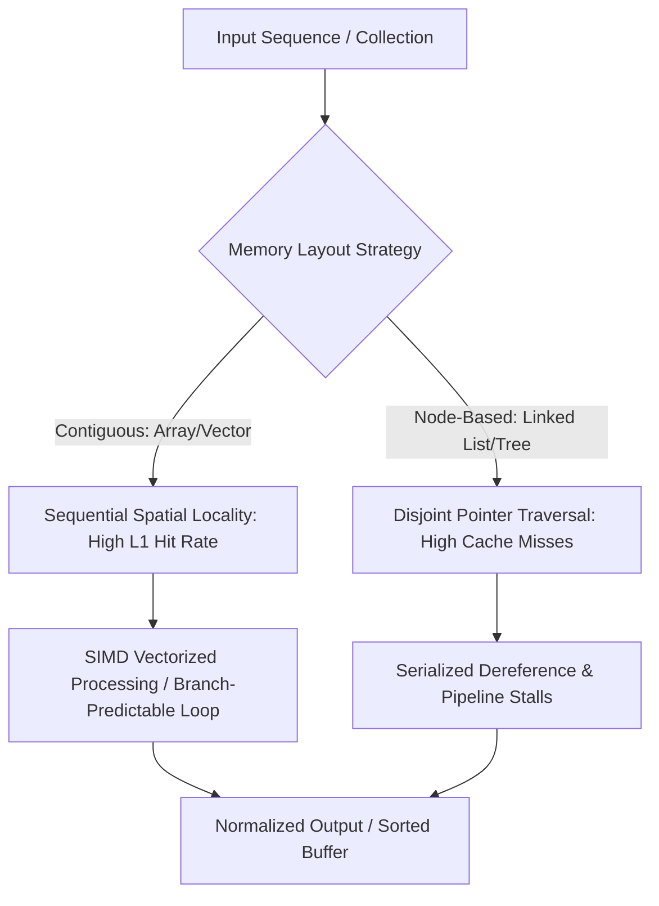

# Data Structures & Algorithms (Parallel Baseline Foundations)

A foundational curriculum covering core data structures, graph algorithms, and algorithmic complexity analysis, serving as the CPU reference and architectural baseline before GPU parallelization.

---

## Module Overview

- **[Module 00: Introduction & Big O Notation](./00-Introduction-BigO/)**: Algorithmic complexity, asymptotic bounds, memory layout fundamentals, and CPU cache hierarchy.
- **[Module 01: Arrays & Strings](./01-Arrays-Strings/)**: Contiguous memory allocations, vector growth mechanics, sliding windows, and cache line spatial locality.
- **[Module 02: Stacks & Queues](./02-Stacks-Queues/)**: LIFO and FIFO execution semantics, ring buffers, and call-stack memory models.
- **[Module 03: Linked Lists](./03-Linked-Lists/)**: Node-pointer networks, cache-invalidation challenges, singly/doubly linked chains, and pointer chasing bottlenecks.
- **[Module 04: Searching & Sorting](./04-Searching-Sorting/)**: Binary search, QuickSort, MergeSort, and comparative sorting lower bounds ($O(N \log N)$).
- **[Module 05: Trees](./05-Trees/)**: Binary search trees (BST), balanced trees (AVL/Red-Black), segment trees, and hierarchical spatial indexing.
- **[Module 06: Graphs](./06-Graphs/)**: Adjacency lists vs. adjacency matrices, Breadth-First Search (BFS), Depth-First Search (DFS), Dijkstra's shortest path, and topological sorting.

---

## Educational & Memory Flow Architecture

### 1. Memory Hierarchy & Dataflow Architecture
```text
+---------------------------------------------------------------------------------+
| System Main Memory (DRAM / Host RAM) - High Latency (~60-100 ns)                |
+---------------------------------------------------------------------------------+
        |  Hardware Pre-fetcher / 64-byte Cache Line Burst  ^  Write-Back / Flush
        v                                                   |
+---------------------------------------------------------------------------------+
| Last Level Cache (L3 Cache / Shared LLC) - Moderate Latency (~30-50 cycles)     |
+---------------------------------------------------------------------------------+
        |  Core-Private Slicing                             ^
        v                                                   |
+---------------------------------------------------------------------------------+
| L1 / L2 Data Caches (Fast On-Chip SRAM) - Low Latency (~4-14 cycles)            |
+---------------------------------------------------------------------------------+
        |  Register Load / Vector Read                      ^
        v                                                   |
+---------------------------------------------------------------------------------+
| CPU General Purpose Registers (GPR) & SIMD Registers (AVX-512 / NEON)           |
+---------------------------------------------------------------------------------+
```

### 2. Execution & Dataflow Graph


### 3. Algorithmic Memory Footprint & Hardware Efficiency Principles
- **Spatial Locality & Cache Lines:** Modern CPUs fetch memory in 64-byte cache lines. Contiguous flat arrays maximize cache line utilization, whereas pointer-chasing structures (linked lists, node trees) result in severe cache thrashing and pipeline stalls.
- **Branch Prediction & Pipeline Depth:** Highly predictable branches (such as linear scans or branchless partition routines) prevent expensive CPU instruction pipeline flushes.
- **SIMD Auto-Vectorization:** Structuring algorithms with contiguous memory strides allows compilers to emit AVX2/AVX-512 instructions, processing 8–16 values per cycle.
- **External Memory Complexity:** Understanding when algorithms exceed on-chip cache capacities and transitioning to external memory / block-tiled strategies.

### 4. Mathematical & Architectural Key Principles
- **Arithmetic Intensity & Roofline Model:** Bound algorithm efficiency by maximizing operations per byte transferred from DRAM:
  $$\text{Operational Intensity} = \frac{\text{Operations}}{\text{Bytes Transferred}}$$
- **Latency Hiding:** Software pipelines and out-of-order execution overlap cache fills with non-dependent arithmetic.
- **Contiguous Alignment:** Memory alignment along 64-byte cache boundaries avoids split cache line access penalties.

---
