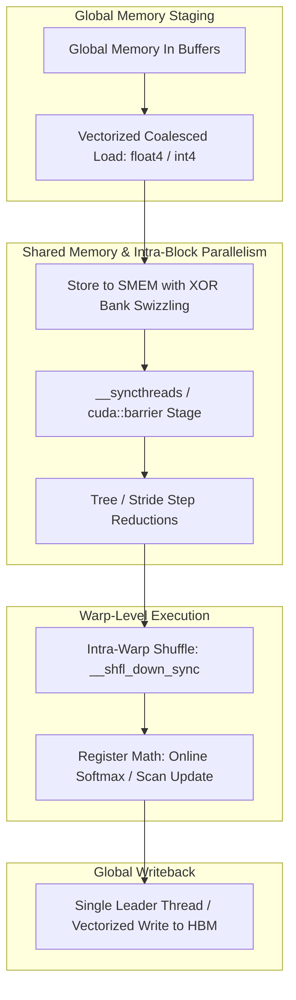

# GPU Data Structures & Algorithms (GPU-DSA)

High-performance parallel algorithms and data structures redesigned from first principles to exploit massively parallel GPU architectures, warp-level primitives, and memory hierarchies.

---

## Module Overview

- **[Parallel Reduction](./Parallel_Reduction/)**: Tree-based reduction, warp-shuffle intrinsics (`__shfl_down_sync`), multi-stage grid reductions.
- **[Parallel Prefix Sum (Scan)](./Parallel_Prefix_Sum/)**: Work-efficient Blelloch scan, Kogge-Stone parallel scan, and single-pass decoupled look-back.
- **[Shared Memory Swizzling](./Shared_Memory_Swizzling/)**: XOR-based swizzle functions to completely eliminate 32-way shared memory bank conflicts.
- **[Radix Sort & Bitonic Sort](./Radix_Sort/)**: GPU parallel sorting networks, local histogramming, and multi-pass prefix-sum scatter.
- **[Online Softmax](./Online_Softmax/)**: Numerically stable, single-pass running maximum and sum updates, eliminating redundant DRAM round-trips.
- **[PagedAttention](./PagedAttention/)**: Non-contiguous KV-cache memory management via virtual-to-physical block mapping tables (vLLM architecture).
- **[FlashAttention](./FlashAttention/)**: SRAM-tiled attention kernel with online softmax recomputation, scaling context lengths linearly in memory.
- **[Double Buffering & Async Copy](./Double_Buffering_Async_Copy/)**: Overlapping compute with memory transfers using `cp.async` and multi-stage circular pipelines.
- **[Fused Layer Normalization](./Fused_Layer_Normalization/)**: Single-kernel reduction, mean/variance calculation, and affine scaling in registers.
- **[Z-Curve / Morton Order](./Z_Curve_Morton_Order/)**: Space-filling curve bit interleaving for high 2D/3D cache locality.
- **[Parallel Histogramming](./Parallel_Histogramming/)**: Warp-aggregated atomic additions and shared-memory privatization.
- **[Compressed Sparse Formats](./Compressed_Sparse_Formats/)**: CSR, CSC, and Blocked-Ellpack implementations for sparse matrix workloads.
- **[Tiled Matrix Multiplication](./Tiled_Matrix_Multiplication/)**: 2D block-tiled GEMM exploiting shared memory staging and register-level outer products.

---

## Educational & Memory Flow Architecture

### 1. Memory Hierarchy & Dataflow Architecture
```text
+---------------------------------------------------------------------------------+
| GPU Global Memory (HBM3 / GDDR6X) - Array / Tensor Buffers                      |
+---------------------------------------------------------------------------------+
        |  128-bit Vectorized Load / cp.async               ^  Coalesced Global Write
        v                                                   |
+---------------------------------------------------------------------------------+
| Shared Memory / L1 Cache (Swizzled to eliminate 32-way Bank Conflicts)          |
| Fast On-Chip Scratchpad for Inter-Thread Collaboration & Staged Reductions       |
+---------------------------------------------------------------------------------+
        |  Warp Shuffle (__shfl_sync / __shfl_down_sync)    ^  Shared Accumulation
        v                                                   |
+---------------------------------------------------------------------------------+
| Thread Register File & Functional Units (ALUs, FP32/FP16 Cores, Tensor Cores)   |
+---------------------------------------------------------------------------------+
```

### 2. Execution & Dataflow Graph


### 3. GPU Algorithmic Patterns & Hardware Primitives
- **Warp-Aggregated Atomics:** Filtering atomic operations by electing a single active thread via `__ballot_sync()` to update global memory counters once per warp, dramatically cutting serialization stalls.
- **Decoupled Look-Back Scan:** State-of-the-art parallel prefix sum publishing status flags per tile, allowing downstream blocks to look back and accumulate prefix states without global grid barriers.
- **Double Buffering & Circular Stages:** Employing `cp.async` pipelines across two or more shared memory buffers to continuously fetch tile $k+1$ while computing tile $k$ in registers.
- **XOR Swizzling Layouts:** Permuting 2D array coordinates ($row \oplus (col / \text{banks})$) so that identical bank columns are mapped across distinct physical banks.

### 4. Mathematical & Architectural Key Principles
- **Arithmetic Intensity & Roofline Model:** Bound kernel efficiency by maximizing FLOPS per byte transferred from higher-latency memory tiers:
  $$\text{Operational Intensity} = \frac{\text{Floating Point Operations (FLOPs)}}{\text{Bytes Transferred (DRAM \leftrightarrow SRAM)}}$$
- **Latency Hiding:** Software pipelines overlap asynchronous global loads with compute stages across unrolled loops.
- **Memory Coalescing & Bank Alignment:** Aligned memory accesses ensure full 32-byte or 128-byte transactions, preventing pipeline stalls.

---
