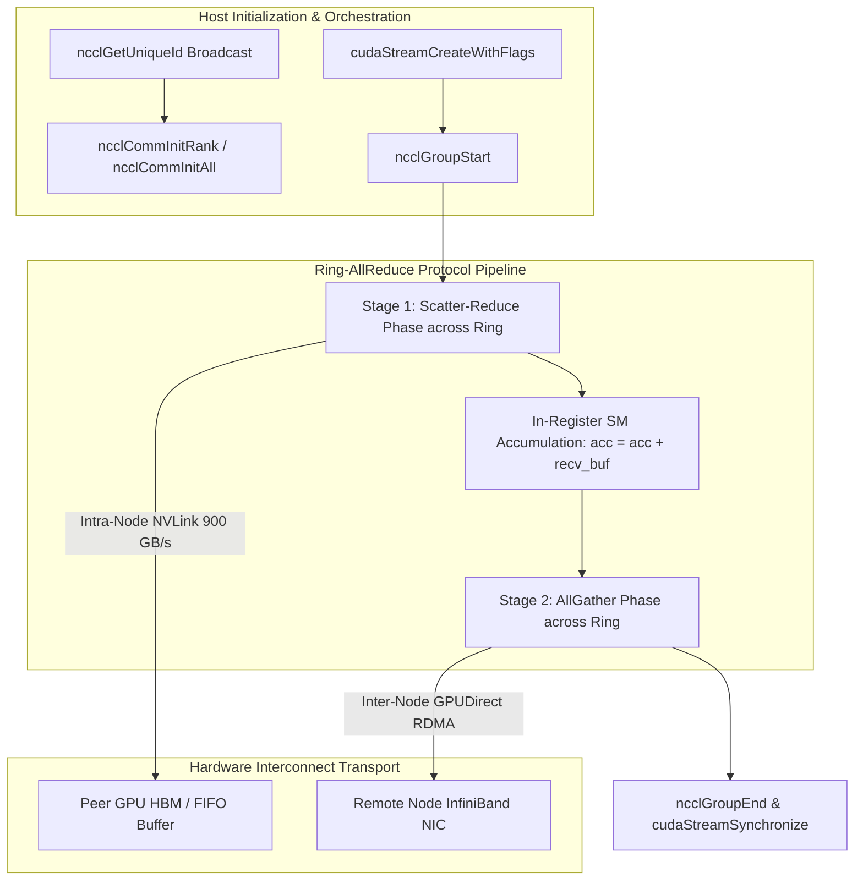

# NCCL: NVIDIA Collective Communications Library Learning Path

A comprehensive guide to multi-GPU and multi-node collective communication primitives, inter-GPU interconnect topologies, and high-performance distributed training communication algorithms.

---

## Module Overview

- **[Module 01: Introduction & Environment Setup](./Module-01/)**: NCCL fundamentals, runtime architecture, CUDA interop, and initialization patterns.
- **[Module 02: Basic Collective Operations](./Module-02/)**: Point-to-point transfers, `ncclAllReduce`, `ncclBroadcast`, and synchronization.
- **[Module 03: Advanced Collectives](./Module-03/)**: `ncclReduce`, `ncclAllGather`, `ncclReduceScatter`, and custom reduction operators.
- **[Module 04: Multi-GPU Programming](./Module-04/)**: Multi-process vs. multi-threaded GPU orchestration, NUMA node binding, and stream synchronization.
- **[Module 05: Performance Optimization](./Module-05/)**: Ring vs. Tree algorithms, NVLink saturations, buffer sizing, and latency hiding via communication-computation overlap.
- **[Module 06: Troubleshooting & Best Practices](./Module-06/)**: Deadlock prevention, NCCL debug logging, hang detection, and topology diagnosis.
- **[Module 07: Real-world Applications](./Module-07/)**: Distributed Data Parallel (DDP), Megatron-LM tensor parallel communication, and pipeline parallel activation passing.

---

## Educational & Memory Flow Architecture

### 1. Memory Hierarchy & Dataflow Architecture
```text
+---------------------------------------------------------------------------------+
| Host Memory (Pinned Stage / InfiniBand Host Channel Adapter RDMA Buffer)        |
+---------------------------------------------------------------------------------+
        |  GPUDirect RDMA / PCIe Gen5 Transfer              ^
        v                                                   |
+---------------------------------------------------------------------------------+
| Local GPU Global Memory (HBM3e / GDDR6X) Tensor Buffers                         |
+---------------------------------------------------------------------------------+
        |  Direct NVLink 4/5 Inter-GPU Transfer            ^
        v                                                   |
+---------------------------------------------------------------------------------+
| Inter-GPU Peer Shared Fifo Buffers (NCCL Ring / Tree Channel Memory)            |
+---------------------------------------------------------------------------------+
        |  Vectorized 128-bit Accumulation / Reduction     ^
        v                                                   |
+---------------------------------------------------------------------------------+
| Streaming Multiprocessor (SM) Warps & Thread Registers (ncclKernel Execution)   |
+---------------------------------------------------------------------------------+
```

### 2. Execution & Dataflow Graph


### 3. Modern NCCL API Standards & Architecture Guide
- **Grouped Collective Operations:** Wrapping batched collective launches within `ncclGroupStart()` and `ncclGroupEnd()` to aggregate kernel launches into single network barrier waves.
- **Direct P2P & GPUDirect RDMA:** Leveraging direct memory access without CPU bouncing via NVLink across local GPUs and RoCEv2/InfiniBand across distributed nodes.
- **Communication-Computation Overlap:** Dedicated CUDA streams for NCCL operations running concurrently with backward gradient passes or forward compute streams.
- **Topology-Aware Routing:** Automatic detection and channel assignment across NVLink mesh topologies, NVSwitch fabrics, and PCIe tree roots.

### 4. Mathematical & Architectural Key Principles
- **Ring AllReduce Complexity & Bandwidth Efficiency:**
  $$\text{Data Transferred per GPU} = 2 \left(\frac{N - 1}{N}\right) \times S$$
  where $N$ is the number of GPU ranks and $S$ is the total message buffer size in bytes. As $N$ grows large, total network transmission per GPU approaches $2S$, making bandwidth utilization independent of rank count.
- **Tree AllReduce for Small Latency-Bound Messages:** Tree topologies reduce algorithmic latency hops to $2 \log_2(N)$ at the expense of lower aggregate link bandwidth utilization, optimal for small metadata synchronization.
- **Latency Hiding:** Software pipelines overlap asynchronous global loads with compute stages across unrolled loops.
- **Memory Coalescing & Bank Alignment:** Aligned memory accesses ensure full 32-byte or 128-byte transactions, preventing pipeline stalls.

---
