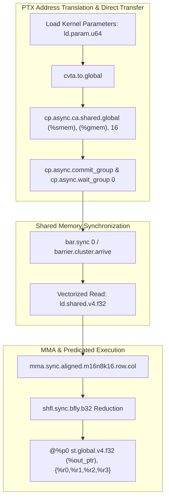

# PTX Learning Path: From Basics to Expert GPU Kernel Engineering

Welcome to the comprehensive PTX learning path! This structured curriculum is designed to take you from a beginner understanding of PTX assembly language to an expert level in GPU kernel engineering.

## Overview

This learning path is divided into five progressive modules, each building upon the previous one:

1. **PTX-Basics** - Introduction to PTX syntax, structure, and basic concepts
2. **PTX-Memory-Management** - Memory spaces, access patterns, and optimization techniques
3. **PTX-Debugging-Profiling** - Debugging tools, profiling methods, and performance analysis
4. **PTX-Advanced-Optimizations** - Advanced optimization techniques and warp-level primitives
5. **PTX-Custom-Kernels** - Complete custom kernel development and integration

Each module includes:
- Comprehensive README with learning objectives and concepts
- Practical exercises to reinforce learning
- Sample code and test harnesses
- Performance analysis tools and techniques

## Learning Path

### Module 1: PTX Basics
Start here if you're new to PTX or GPU programming. This module covers:
- PTX syntax and structure
- Basic instructions and data types
- Relationship between CUDA C/C++ and PTX
- Simple PTX programs

**Directory**: `PTX-Basics/`

### Module 2: Memory Management and Optimization
Once you understand the basics, dive into memory concepts:
- Different memory spaces in PTX
- Memory access optimization
- Coalescing and memory patterns
- Shared memory usage

**Directory**: `PTX-Memory-Management/`

### Module 3: Debugging and Profiling
Learn to debug and profile your PTX code:
- Common debugging tools (cuobjdump, cuda-gdb, etc.)
- Profiling techniques and metrics
- Performance analysis
- Bottleneck identification

**Directory**: `PTX-Debugging-Profiling/`

### Module 4: Advanced Optimizations
Master advanced optimization techniques:
- Instruction-level parallelism
- Warp-level primitives
- Specialized instructions and intrinsics
- Cooperative groups in PTX

**Directory**: `PTX-Advanced-Optimizations/`

### Module 5: Custom Kernels
Apply all knowledge to develop custom kernels:
- End-to-end kernel development process
- Domain-specific kernel design (AI/ML, scientific computing, graphics)
- Hardware architecture considerations
- Integration with higher-level frameworks

**Directory**: `PTX-Custom-Kernels/`

## Prerequisites

Before starting this learning path, you should have:
- Basic understanding of C/C++ programming
- Familiarity with GPU computing concepts
- Access to a CUDA-capable GPU
- CUDA toolkit installed (nvcc, cuobjdump, profilers)

## Tools You'll Need

Throughout this learning path, you'll use these tools:
- `nvcc` - NVIDIA CUDA Compiler
- `cuobjdump` - CUDA object dump utility
- `nvdisasm` - NVIDIA disassembler
- `Nsight Compute` - NVIDIA profiler
- `Nsight Systems` - System-wide profiler
- `cuda-gdb` - GPU debugger
- `nvprof` - NVIDIA profiler (legacy)

## Getting Started

1. Start with the **PTX-Basics** module
2. Work through each module sequentially
3. Complete the exercises in each module
4. Practice with the sample code
5. Experiment with your own modifications

## Progression Tips

- Don't rush through modules; master each concept before moving on
- Practice with the exercises to reinforce learning
- Experiment with the sample code to deepen understanding
- Use the debugging and profiling tools regularly
- Apply concepts to your own projects as you advance

## Becoming an Expert GPU Kernel Engineer

By completing this learning path, you will gain the skills to:
- Write and optimize PTX code for maximum performance
- Debug complex GPU kernel issues
- Profile and analyze kernel performance
- Design custom kernels for specific applications
- Integrate PTX kernels with higher-level frameworks
- Optimize kernels for different GPU architectures

## Additional Resources

- [NVIDIA PTX ISA Documentation](https://docs.nvidia.com/cuda/parallel-thread-execution/)
- [CUDA Programming Guide](https://docs.nvidia.com/cuda/cuda-c-programming-guide/)
- [Optimization Guidelines](https://docs.nvidia.com/cuda/cuda-c-best-practices/index.html)

## Next Steps

Begin your journey by exploring the `PTX-Basics/` directory and working through the introductory materials. Each module contains exercises to reinforce the concepts, so be sure to practice what you learn!

Good luck on your path to becoming an expert GPU kernel engineer!


---

## Educational & Memory Flow Architecture

### 1. Memory Hierarchy & Dataflow Architecture
```text
+---------------------------------------------------------------------------------+
| Global Memory (.global) / Constant Memory (.const) / Parameter (.param)          |
+---------------------------------------------------------------------------------+
        |  cp.async.ca / cp.async.cg (Direct Bypass to SMEM) ^  st.global.v4
        v                                                    |
+---------------------------------------------------------------------------------+
| Shared Memory (.shared) / Distributed Shared Memory (.shared::cluster)          |
| Addressed via cvta.to.shared / ld.shared.v4 / st.shared.v4                       |
+---------------------------------------------------------------------------------+
        |  ld.shared / cvt / shfl.sync                      ^  bar.sync / bar.arrive
        v                                                    |
+---------------------------------------------------------------------------------+
| Virtual Registers (%r0..%rN, %f0..%fN, Predicates %p0..%pN)                      |
| Direct Tensor Core MMA Execution (mma.sync.aligned.m16n8k16)                    |
+---------------------------------------------------------------------------------+
```

### 2. Execution & Dataflow Graph


### 3. PTX ISA Architecture & Low-Level Instruction Optimization
- **Explicit Memory Spaces:** Distinct instructions for distinct memory segments (`ld.global`, `ld.shared`, `ld.local`, `ld.const`, `ld.param`) avoiding costly generic address translation (`cvta`).
- **Asynchronous Load Pipelines (`cp.async`):** Bypass register files completely during Global-to-Shared memory transactions, minimizing register pressure and warp stall cycles.
- **Tensor Core MMA Instructions:** Low-level matrix multiply-accumulate intrinsics (`mma.sync.aligned.m16n8k16` / `wgmMA` on SM90) maximizing hardware math pipeline saturation.
- **Predicated Execution:** Replaces branching with predicate registers (`@%p0 bra label` or `@%p1 add.f32`) to completely avoid warp divergence.

### 4. Mathematical & Architectural Key Principles
- **Arithmetic Intensity & Roofline Model:** Bound kernel efficiency by maximizing FLOPS per byte transferred from higher-latency memory tiers:
  $$\text{Operational Intensity} = \frac{\text{Floating Point Operations (FLOPs)}}{\text{Bytes Transferred (DRAM \leftrightarrow SRAM)}}$$
- **Latency Hiding:** Software pipelines overlap asynchronous global loads with compute stages across unrolled loops.
- **Memory Coalescing & Bank Alignment:** Aligned memory accesses ensure full 32-byte or 128-byte transactions, preventing pipeline stalls.

---
