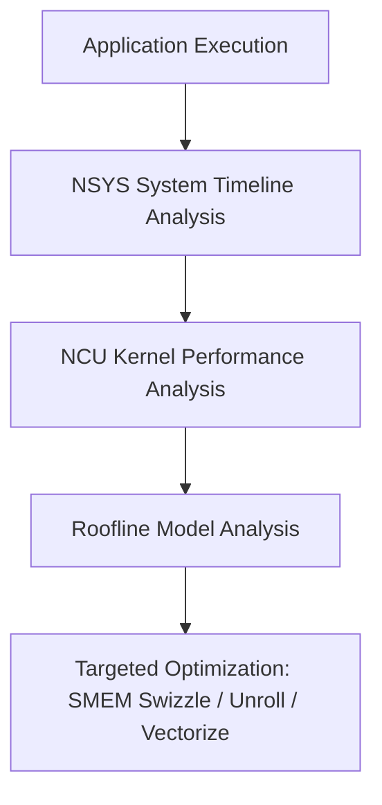

# GPU Kernel Profiling and Optimization Mastery

Welcome to the comprehensive learning path for GPU kernel profiling and optimization! This course is designed for complete beginners who want to master the art of identifying and optimizing GPU kernel bottlenecks.

## Course Overview

This learning path is structured as 8 progressive modules, each building upon the previous one. You'll start with fundamental concepts and gradually advance to real-world optimization scenarios.

### Learning Path

1. **Module 1**: Introduction to GPU Computing and Profiling Concepts
2. **Module 2**: Setting up Profiling Tools and Environment  
3. **Module 3**: Basic Profiling Techniques
4. **Module 4**: Identifying Common Bottlenecks
5. **Module 5**: Memory Optimization Techniques
6. **Module 6**: Computational Optimization Strategies
7. **Module 7**: Advanced Profiling and Analysis
8. **Module 8**: Real-world Case Studies and Practice

## Prerequisites

- Basic programming knowledge (C/C++, Python, or similar)
- Understanding of fundamental computer science concepts
- Access to a GPU (NVIDIA/AMD) for hands-on practice
- Familiarity with command-line tools

## What You'll Learn

By the end of this course, you will be able to:
- Understand GPU architecture and how it differs from CPU computing
- Set up and use various GPU profiling tools
- Identify performance bottlenecks in GPU kernels
- Apply optimization techniques to improve kernel performance
- Analyze profiling data to make informed optimization decisions
- Solve real-world GPU optimization challenges

## Getting Started

Start with Module 1 and work through each module sequentially. Each module contains:
- A README explaining the concepts
- Practical code examples to experiment with
- Exercises to reinforce your learning

Let's begin your journey to GPU optimization mastery!


---

## Educational & Memory Flow Architecture

### 1. Memory Hierarchy & Dataflow Architecture
```text
+---------------------------------------------------------------------------------+
| Hardware Performance Monitors & PM Counters                                    |
+---------------------------------------------------------------------------------+
        |  NCU Sampling / NSYS Timeline Tracing             ^
        v                                                   |
+---------------------------------------------------------------------------------+
| Bottleneck Categorization: Memory Bound vs Compute Bound vs Latency Bound        |
+---------------------------------------------------------------------------------+
        |  Architectural Optimization Recommendations       ^
        v                                                   |
+---------------------------------------------------------------------------------+
| Maximum Achieved Hardware Speed-of-Light (SOL %)                                 |
+---------------------------------------------------------------------------------+
```

### 2. Execution & Dataflow Graph


### 3. Modern GPU Profiling & Performance Analysis Architecture
- **Nsight Compute (NCU):** Measuring Speed-of-Light (SOL), Memory Chart analysis, warp stall sampling, and shared memory bank conflict detection.
- **Nsight Systems (NSYS):** System-wide tracing across CUDA APIs, kernel execution timelines, NVLink throughput, and CPU-GPU overlap.
- **CUDA Occupancy Calculator:** Balancing registers per thread and shared memory per block to achieve optimal active warps per SM.
- **Roofline Analysis:** Identifying compute-bound vs. memory-bound operating regimes.

### 4. Mathematical & Architectural Key Principles
- **Arithmetic Intensity & Roofline Model:** Bound kernel efficiency by maximizing FLOPS per byte transferred from higher-latency memory tiers:
  $$\text{Operational Intensity} = \frac{\text{Floating Point Operations (FLOPs)}}{\text{Bytes Transferred (DRAM \leftrightarrow SRAM)}}$$
- **Latency Hiding:** Software pipelines overlap asynchronous global loads with compute stages across unrolled loops.
- **Memory Coalescing & Bank Alignment:** Aligned memory accesses ensure full 32-byte or 128-byte transactions, preventing pipeline stalls.

---
