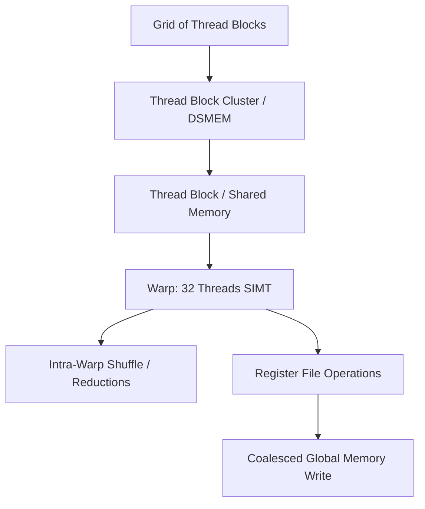

# ThunderKittens Fill-in Tutorial Track

This directory mirrors the educational GEMM tutorial layout with explicit `starter` and `solution` code paths.

## Layout

- `gemm_h100/`: Hopper track (`level_01` to `level_08`)
- `gemm_b200/`: Blackwell track (`level_01` to `level_09`)

Each level has:

- `level_XX_starter.cu`: fill-in exercise file with `TODO(...)` markers
- `level_XX_solution.cu`: completed reference implementation

Each track also has:

- `Makefile`: same flow as existing educational kernels, plus `TRACK=starter|solution`
- `launch.cu`: benchmark/correctness harness

## Build and run

Example (H100 level 04 starter):

```bash
cd tutorials/fill_in/gemm_h100
make LEVEL=04 TRACK=starter clean
make LEVEL=04 TRACK=starter run
```

Compare with solution:

```bash
make LEVEL=04 TRACK=solution clean
make LEVEL=04 TRACK=solution run
```

## Recommended learning order

1. H100: `01 -> 08`
2. B200: `01 -> 09`
3. Refactor one solved level into `prototype::lcf`


---

## Educational & Memory Flow Architecture

### 1. Memory Hierarchy & Dataflow Architecture
```text
+---------------------------------------------------------------------------------+
| Host Memory (Pinned / Page-Locked)                                              |
+---------------------------------------------------------------------------------+
        |  cudaMemcpyAsync / Unified Memory Pre-fetch       ^
        v                                                   |
+---------------------------------------------------------------------------------+
| Device Global Memory (HBM3 / GDDR6X)                                            |
+---------------------------------------------------------------------------------+
        |  128-bit Vectorized Load / cp.async               ^  Coalesced Store
        v                                                   |
+---------------------------------------------------------------------------------+
| Shared Memory / L1 Data Cache (Bank Conflict Free via Swizzling / Padding)      |
+---------------------------------------------------------------------------------+
        |  Warp Shuffle (__shfl_sync) / Register Load       ^
        v                                                   |
+---------------------------------------------------------------------------------+
| Thread Register File (High Bandwidth, 0-cycle stall when unrolled)              |
+---------------------------------------------------------------------------------+
```

### 2. Execution & Dataflow Graph


### 3. Modern CUDA 12.x+ & Hardware Optimization Architecture
- **Asynchronous Copies (`cp.async`):** Hardware-accelerated memory movement directly from Global Memory to Shared Memory bypassing general registers.
- **Warp Shuffle Synchronization:** Deprecating naked shuffle intrinsics in favor of mask-enforced `__shfl_sync(0xFFFFFFFF, val, lane)`.
- **Thread Block Clusters:** Utilizing CUDA 12+ cluster dimensions (`__cluster_dims__`) for Distributed Shared Memory (DSMEM) communication across SMs.
- **Stream-Ordered Allocation:** `cudaMallocAsync` and `cudaFreeAsync` integrated with CUDA Graphs to eliminate host launch overheads.

### 4. Mathematical & Architectural Key Principles
- **Arithmetic Intensity & Roofline Model:** Bound kernel efficiency by maximizing FLOPS per byte transferred from higher-latency memory tiers:
  $$\text{Operational Intensity} = \frac{\text{Floating Point Operations (FLOPs)}}{\text{Bytes Transferred (DRAM \leftrightarrow SRAM)}}$$
- **Latency Hiding:** Software pipelines overlap asynchronous global loads with compute stages across unrolled loops.
- **Memory Coalescing & Bank Alignment:** Aligned memory accesses ensure full 32-byte or 128-byte transactions, preventing pipeline stalls.

---
