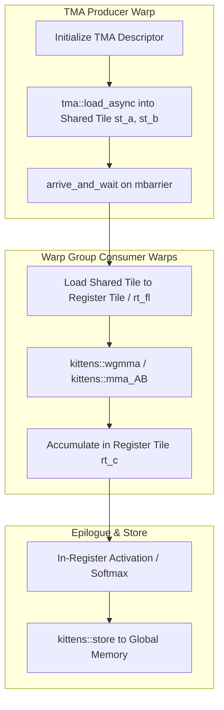

# ThunderKittens Fill-in Tutorial Track

This directory mirrors the educational GEMM tutorial layout with explicit `starter` and `solution` code paths.

## Layout

- `gemm_h100/`: Hopper track (`level_01` to `level_08`)
- `gemm_b200/`: Blackwell track (`level_01` to `level_09`)

Each level has:

- `level_XX_starter.cu`: fill-in exercise file with `TODO(...)` markers
- `level_XX_solution.cu`: completed reference implementation

Each track also has:

- `Makefile`: same flow as existing educational kernels, plus `TRACK=starter|solution`
- `launch.cu`: benchmark/correctness harness

## Build and run

Example (H100 level 04 starter):

```bash
cd tutorials/fill_in/gemm_h100
make LEVEL=04 TRACK=starter clean
make LEVEL=04 TRACK=starter run
```

Compare with solution:

```bash
make LEVEL=04 TRACK=solution clean
make LEVEL=04 TRACK=solution run
```

## Recommended learning order

1. H100: `01 -> 08`
2. B200: `01 -> 09`
3. Refactor one solved level into `prototype::lcf`


---

## Educational & Memory Flow Architecture

### 1. Memory Hierarchy & Dataflow Architecture
```text
+---------------------------------------------------------------------------------+
| Global Memory (TMA Descriptors & High-Bandwidth Memory)                         |
+---------------------------------------------------------------------------------+
        |  tma::load_async / kittens::load (Direct to SMEM) ^  kittens::store
        v                                                   |
+---------------------------------------------------------------------------------+
| Shared Memory Tile: kittens::st_fl<ROWS, COLS> / st_bf<ROWS, COLS>              |
| Hardware Swizzled via TMA & Circular Barrier Synchronization                    |
+---------------------------------------------------------------------------------+
        |  kittens::load(rt, st) / WGMMA Direct Operands    ^
        v                                                   |
+---------------------------------------------------------------------------------+
| Register Tile: kittens::rt_fl<ROWS, COLS> & Accumulator Tiles                   |
| kittens::mma / kittens::wgmMA Warp Group Tensor Core Matrix Multiplication       |
+---------------------------------------------------------------------------------+
```

### 2. Execution & Dataflow Graph


### 3. ThunderKittens Embedded Domain-Specific Architecture
- **Tile-Centric Type System:** Strong compile-time types for Shared Memory tiles (`st_fl`, `st_bf`, `st_half`) and Register tiles (`rt_fl`, `rt_bf`) with statically checked dimensions.
- **Hopper (H100) & Blackwell (B200) WGMMA:** Direct hardware abstraction for Warp Group Matrix Multiply and Accumulate (`wgmma.mma_async`), operating across 128 threads simultaneously.
- **Asynchronous TMA Tiling:** Seamless integration with NVIDIA Tensor Memory Accelerator, offloading address calculations and strides to dedicated hardware.
- **Micro-Kernel Composability:** High-level mathematical operations (`kittens::mul`, `kittens::add`, `kittens::exp`, `kittens::row_max`) implemented directly on typed tile structures without raw indexing boilerplate.

### 4. Mathematical & Architectural Key Principles
- **Arithmetic Intensity & Roofline Model:** Bound kernel efficiency by maximizing FLOPS per byte transferred from higher-latency memory tiers:
  $$\text{Operational Intensity} = \frac{\text{Floating Point Operations (FLOPs)}}{\text{Bytes Transferred (DRAM \leftrightarrow SRAM)}}$$
- **Latency Hiding:** Software pipelines overlap asynchronous global loads with compute stages across unrolled loops.
- **Memory Coalescing & Bank Alignment:** Aligned memory accesses ensure full 32-byte or 128-byte transactions, preventing pipeline stalls.

---
