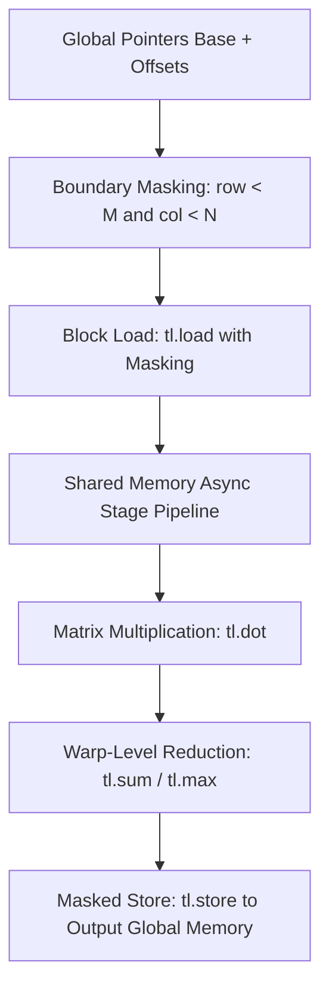

# Triton Learning Modules

Welcome to the comprehensive Triton learning path! This repository contains a structured set of modules designed to teach Triton programming for GPU acceleration, starting from the basics and progressing to advanced techniques.

## Overview

Triton is a domain-specific language (DSL) that enables researchers and developers to write custom PyTorch operations that run on GPUs, with performance close to hand-written CUDA while being much easier to develop and maintain.

This learning path is organized into 8 progressive modules:

### [Module 1: Introduction to Triton and Basic Tensor Operations](Module-01-Basics/)
- Learn the basic structure of Triton programs
- Understand kernel functions and decorators
- Perform simple tensor operations
- Get familiar with the Triton programming model

### [Module 2: Memory Operations and Data Movement](Module-02-Memory/)
- Understand GPU memory hierarchy
- Learn efficient memory loading and storing
- Master coalesced access patterns
- Handle boundary conditions properly

### [Module 3: Basic Arithmetic and Element-wise Operations](Module-03-Arithmetic/)
- Perform element-wise mathematical operations
- Use Triton's mathematical functions
- Implement arithmetic expressions
- Understand broadcasting concepts

### [Module 4: Block Operations and Tiling Concepts](Module-04-Blocks/)
- Work with 2D and higher-dimensional blocks
- Learn tiling strategies for optimization
- Coordinate threads within blocks
- Understand the benefits of tiling

### [Module 5: Matrix Multiplication Fundamentals](Module-05-Matrix-Multiplication/)
- Implement basic matrix multiplication
- Understand tiled matrix multiplication
- Learn optimization strategies
- Appreciate performance benefits

### [Module 6: Advanced Memory Layouts and Optimizations](Module-06-Advanced-Memory/)
- Explore memory coalescing techniques
- Avoid bank conflicts in shared memory
- Implement memory prefetching
- Optimize for cache hierarchies

### [Module 7: Reduction Operations](Module-07-Reductions/)
- Implement sum, max, min reductions
- Learn parallel reduction techniques
- Understand numerical stability in reductions
- Perform reductions along specific axes

### [Module 8: Advanced Techniques and Best Practices](Module-08-Advanced-Techniques/)
- Profile and optimize kernel performance
- Manage numerical precision
- Implement advanced optimization techniques
- Follow best practices for robust code

## Prerequisites

Before starting this learning path, you should have:
- Basic Python programming knowledge
- Understanding of tensors and linear algebra
- Familiarity with PyTorch (helpful but not required)

## Getting Started

1. Install Triton: `pip install triton`
2. Ensure you have a CUDA-compatible GPU
3. Navigate to any module directory
4. Read the README.md for concepts
5. Run the Python examples to see Triton in action
6. Experiment with the code to reinforce your understanding

## Learning Approach

Each module contains:
- A README.md explaining concepts and theory
- Python files with practical examples
- Comments explaining the code in detail
- Exercises to practice what you've learned

Start with Module 1 and work your way through sequentially. Each module builds on the previous ones, gradually increasing in complexity.

## Contributing

If you find issues or have suggestions for improvement, feel free to contribute to this learning resource!

## Resources

- [Official Triton Documentation](https://triton-lang.org/)
- [Triton GitHub Repository](https://github.com/openai/triton)
- [PyTorch Integration](https://pytorch.org/)

Happy learning!


---

## Educational & Memory Flow Architecture

### 1. Memory Hierarchy & Dataflow Architecture
```text
+---------------------------------------------------------------------------------+
| GPU Global Memory (HBM3 / GDDR6X)                                               |
| High Latency (~400-800 cycles), 128-bit aligned tensor segments                 |
+---------------------------------------------------------------------------------+
        |                                                   ^
        | tl.load(ptrs, mask=mask, other=0.0)               | tl.store(ptrs, out, mask=mask)
        v                                                   |
+---------------------------------------------------------------------------------+
| Triton Block SRAM / Shared Memory Pipeline (L1 / SMEM)                          |
| Multi-stage software pipelining (num_stages=3/4/5) hiding DRAM access latency   |
+---------------------------------------------------------------------------------+
        |                                                   ^
        | tl.dot / register tiling                          | Elementwise / Reduction
        v                                                   |
+---------------------------------------------------------------------------------+
| Warp Registers & Tensor Cores                                                   |
| High-throughput MMA operations & warp-level reduction primitives                |
+---------------------------------------------------------------------------------+
```

### 2. Execution & Dataflow Graph


### 3. Modern Triton 3.x API Standards & Architecture Guide
- **`tl.dot` with input precision:** Modern Triton 3.x defaults and requires explicit input precision management: `tl.dot(a, b, input_precision="tf32")` for Ampere/Hopper Tensor Cores.
- **Pipelined Loop Idioms:** Explicit iteration hints with `for k in tl.range(0, K, BLOCK_SIZE_K, num_stages=num_stages)` to enable compiler-driven asynchronous load pipelining.
- **Atomic Operations & Memory Fences:** Direct support for `tl.atomic_add` / `tl.atomic_max` with boundary predication masks (`mask=...`) ensuring atomic convergence without warp divergence.
- **Autotuner Best Practices:** `@triton.autotune(configs=[triton.Config({'BLOCK_SIZE_M': 128, 'BLOCK_SIZE_N': 256, 'BLOCK_SIZE_K': 64}, num_stages=4, num_warps=8)], key=['M', 'N', 'K'])`.

### 4. Mathematical & Architectural Key Principles
- **Arithmetic Intensity & Roofline Model:** Bound kernel efficiency by maximizing FLOPS per byte transferred from higher-latency memory tiers:
  $$\text{Operational Intensity} = \frac{\text{Floating Point Operations (FLOPs)}}{\text{Bytes Transferred (DRAM \leftrightarrow SRAM)}}$$
- **Latency Hiding:** Software pipelines overlap asynchronous global loads with compute stages across unrolled loops.
- **Memory Coalescing & Bank Alignment:** Aligned memory accesses ensure full 32-byte or 128-byte transactions, preventing pipeline stalls.

---
