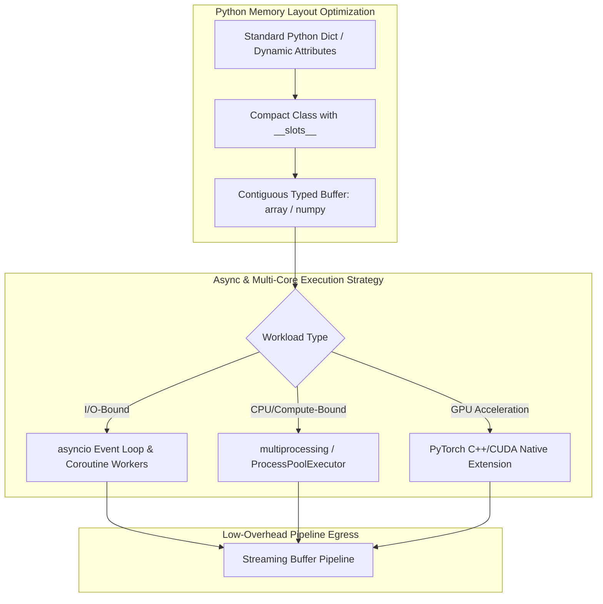

# Python for ML Inference & Kernel Engineering

Speedrun Python for GPU kernel work and systems-level programming — nothing more.

## Prerequisites

- Systems-level thinking (you already have this)
- Basic familiarity with CUDA concepts

## What's Covered

### Core Python for Kernel Engineering

| Module | Topic | Kernel Engineering Relevance | Time |
|--------|-------|------------------------------|------|
| 01 | Functions & Decorators | `@torch.compile`, `@cutlass.jit`, higher-order kernel launchers | 30 min |
| 02 | Comprehensions | Building kernel config grids, tensor shape tuples | 20 min |
| 03 | Dataclasses | Kernel launch configs, tensor metadata structs | 20 min |
| 04 | Context Managers | CUDA streams, `torch.cuda.device`, resource cleanup | 20 min |
| 05 | Type Hints | Tensor shape annotations, IDE support for kernel APIs | 20 min |
| 06 | Tensor Indexing | Attention masks, KV cache slicing, broadcast dims | 40 min |
| 07 | CLI & I/O | Benchmark scripts, path handling for model weights | 20 min |
| 08 | Timing & Benchmarking | CUDA events, `ncu` profiling, benchmark harnesses | 30 min |

### Systems Python (Production-Ready Code)

| Module | Topic | Systems Engineering Relevance | Time |
|--------|-------|------------------------------|------|
| 09 | Async Basics | Concurrent I/O, async inference servers, rate limiting | 30 min |
| 10 | Error Handling | OOM recovery, retry logic, custom exceptions | 30 min |
| 11 | Logging & Debugging | Structured logs, pdb, production observability | 30 min |
| 12 | Testing | pytest, kernel correctness, mocking CUDA | 30 min |

## Capstone

A complete benchmark harness that:
- Parses CLI args (`--kernel`, `--dtype`, `--sizes`)
- Stores config in a `@dataclass`
- Times kernels with CUDA events
- Outputs formatted tables + CSV
- Invokes `ncu` for profiling

## Setup

```bash
python setup.py  # Validates env, prints Python version + torch info
```

## Workflow

1. Complete each `_FILL_IN.py` exercise (10–30 min each)
2. Predict behavior before running
3. Answer checkpoint questions after running
4. Check `solutions/` only if stuck

## Rules

- No OOP. No inheritance. No `__init__`. No class methods.
- Only `@dataclass` as plain structs.
- Every exercise ties to real kernel/systems work.


---

## Educational & Memory Flow Architecture

### 1. Memory Hierarchy & Dataflow Architecture
```text
+---------------------------------------------------------------------------------+
| CPython Virtual Memory: PyObject Reference Graphs & Object Headers (PyObject_HEAD)|
+---------------------------------------------------------------------------------+
        |  __slots__ / Struct Packing / Memory Slicing      ^  Garbage Collector Mark/Sweep
        v                                                   |
+---------------------------------------------------------------------------------+
| Flat Contiguous Buffers: ctypes / numpy.ndarray / torch.Tensor Contiguous Slices |
+---------------------------------------------------------------------------------+
        |  Direct C-ABI Pointer Pass & Zero-Copy FFI        ^
        v                                                   |
+---------------------------------------------------------------------------------+
| Low-Level C/C++/CUDA Extension Execution (libcuda / Native Shared Libraries)     |
+---------------------------------------------------------------------------------+
```

### 2. Execution & Dataflow Graph


### 3. Advanced Python Systems Architecture & HPC Engineering
- **Object Overhead Elimination (`__slots__`):** Stripping dynamic `__dict__` allocations from high-frequency objects, saving 60%+ per-instance memory footprint.
- **Contiguous Memory Interop:** Leveraging contiguous memory strides and standard strides array representations for instantaneous C-FFI / CUDA interop.
- **GIL Mitigation Strategies:** Bypassing GIL constraints using `multiprocessing`, native C extensions, or `torch.compile` which release the GIL during kernel launches.
- **Memory Profiling & Tracing:** Monitoring allocations via `tracemalloc`, detecting memory leaks, and eliminating reference cycles that hinder real-time inference throughput.

### 4. Mathematical & Architectural Key Principles
- **Arithmetic Intensity & Roofline Model:** Bound kernel efficiency by maximizing FLOPS per byte transferred from higher-latency memory tiers:
  $$\text{Operational Intensity} = \frac{\text{Floating Point Operations (FLOPs)}}{\text{Bytes Transferred (DRAM \leftrightarrow SRAM)}}$$
- **Latency Hiding:** Software pipelines overlap asynchronous global loads with compute stages across unrolled loops.
- **Memory Coalescing & Bank Alignment:** Aligned memory accesses ensure full 32-byte or 128-byte transactions, preventing pipeline stalls.

---
