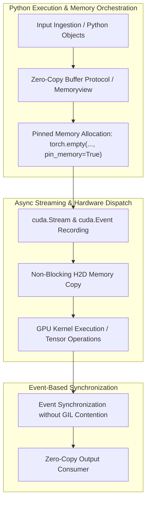

# Python Crash Course for ML Systems & Infrastructure

A hands-on, exercise-driven Python learning path for engineers working on ML systems, inference infrastructure, and production pipelines.

## Who This Is For

- ML engineers who need to write production-grade Python
- Systems engineers building inference servers and data pipelines
- Researchers transitioning code from notebooks to production
- Anyone who needs to understand Python deeply, fast

This is **not** a beginner course. You should know basic programming concepts. We focus on the Python features that matter for ML infrastructure.

## Installation

```bash
# Core dependencies for all modules
pip install torch numpy

# Module 02: Type hints and validation
pip install pydantic pydantic-settings

# Module 03: Async support (built-in, no install needed)

# Module 04: Itertools (built-in, no install needed)

# Module 05: ZeroMQ and multiprocessing
pip install pyzmq

# Module 06: FastAPI and structured logging
pip install fastapi uvicorn[standard] structlog

# Module 07: Benchmarking and observability
pip install memory-profiler line-profiler opentelemetry-api opentelemetry-sdk prometheus-client
```

Or install everything at once:

```bash
pip install torch numpy pydantic pyzmq fastapi uvicorn structlog memory-profiler line-profiler opentelemetry-api opentelemetry-sdk prometheus-client
```

## Modules

| # | Module | Topics | Time |
|---|--------|--------|------|
| 01 | [Tensor Ops + Indexing](module_01_tensor_ops/) | Tensor creation, reshaping, slicing, broadcasting, einsum, strides | 2-3 hours |
| 02 | [Dataclasses + Pydantic + Type Hints](module_02_dataclasses_pydantic/) | Type annotations, @dataclass, Pydantic validation, Protocol | 2-3 hours |
| 03 | [Context Managers + Async Basics](module_03_context_managers_async/) | `with` statement, async/await, async context managers, tasks | 3-4 hours |
| 04 | [Generators + Comprehensions + Streaming](module_04_generators_comprehensions/) | yield, generator pipelines, comprehensions, itertools, lazy evaluation | 2-3 hours |
| 05 | [ZeroMQ + Multiprocessing + Shared Memory](module_05_zeromq_multiprocessing/) | ZMQ sockets, multiprocessing, shared memory, worker patterns | 4-5 hours |
| 06 | [FastAPI + Error Handling + Structured Logging](module_06_fastapi_logging/) | FastAPI routes, Pydantic models, exception handlers, structlog | 3-4 hours |
| 07 | [Timing + Benchmarking + Observability](module_07_timing_observability/) | perf_counter, cProfile, memory profiling, OpenTelemetry, Prometheus | 3-4 hours |

## Recommended Order

1. **Start with Module 01** — Tensor operations are foundational for ML work
2. **Module 02** — Type safety and validation prevent bugs in production
3. **Modules 03-04** — Async and generators are critical for efficient I/O and pipelines
4. **Module 05** — Multiprocessing and ZMQ for scaling beyond single-process limits
5. **Modules 06-07** — API serving and observability for production deployment

Total estimated time: **19-26 hours** for complete coverage

## How to Use

1. Read the module README for context and concepts
2. Work through exercises in order (01 → 02 → 03 → 04)
3. Fill in the `# TODO:` sections
4. Run the file to check your answers
5. Compare with solutions if stuck

```bash
# Run an exercise
python module_01_tensor_ops/01_basics.py

# Run a solution to see how it's done
python module_01_tensor_ops/solutions/01_basics_solution.py
```

## Philosophy

- **Learn by doing**: Every concept is taught through code you write
- **Real-world context**: Exercises mirror actual ML infrastructure problems
- **Self-checking**: Assertions tell you immediately if you're correct
- **No hand-holding**: Comments explain the "why", not just the "what"

## License

MIT License — use this for learning, teaching, or adapting in your own projects.


---

## Educational & Memory Flow Architecture

### 1. Memory Hierarchy & Dataflow Architecture
```text
+---------------------------------------------------------------------------------+
| Host Physical DRAM (CPython Heap / Raw Memory Buffers)                          |
+---------------------------------------------------------------------------------+
        |  NumPy ndarray / PyTorch Tensor Views (Zero-Copy Slicing) ^  Cache Flush
        v                                                           |
+---------------------------------------------------------------------------------+
| Pinned Host Memory (Page-Locked DRAM Buffers / Shared Memory Posix IPC)         |
+---------------------------------------------------------------------------------+
        |  Asynchronous cudaMemcpyAsync via CUDA Streams            ^
        v                                                           |
+---------------------------------------------------------------------------------+
| GPU Device Global Memory & Tensor Accelerators (Zero-Copy DLPack Pointer FFI)   |
+---------------------------------------------------------------------------------+
```

### 2. Execution & Dataflow Graph


### 3. Python HPC Memory Flow & Architectural Best Practices
- **Zero-Copy Memoryviews & Buffer Protocol:** Passing pointers across C extensions, NumPy, and PyTorch using the standard Python buffer protocol to prevent unnecessary host-side data replication.
- **Pinned (Page-Locked) Memory Buffers:** Allocating page-locked host memory to enable high-throughput DMA engine transfers without CPU paging interrupts.
- **Non-blocking Stream Asynchrony:** Decoupling GPU compute streams from the Python GIL (Global Interpreter Lock) to achieve true concurrent execution.
- **Inter-Process Shared Memory (`multiprocessing.shared_memory`):** High-bandwidth inter-process communication for distributed workers without IPC serialization overhead.

### 4. Mathematical & Architectural Key Principles
- **Arithmetic Intensity & Roofline Model:** Bound kernel efficiency by maximizing FLOPS per byte transferred from higher-latency memory tiers:
  $$\text{Operational Intensity} = \frac{\text{Floating Point Operations (FLOPs)}}{\text{Bytes Transferred (DRAM \leftrightarrow SRAM)}}$$
- **Latency Hiding:** Software pipelines overlap asynchronous global loads with compute stages across unrolled loops.
- **Memory Coalescing & Bank Alignment:** Aligned memory accesses ensure full 32-byte or 128-byte transactions, preventing pipeline stalls.

---
