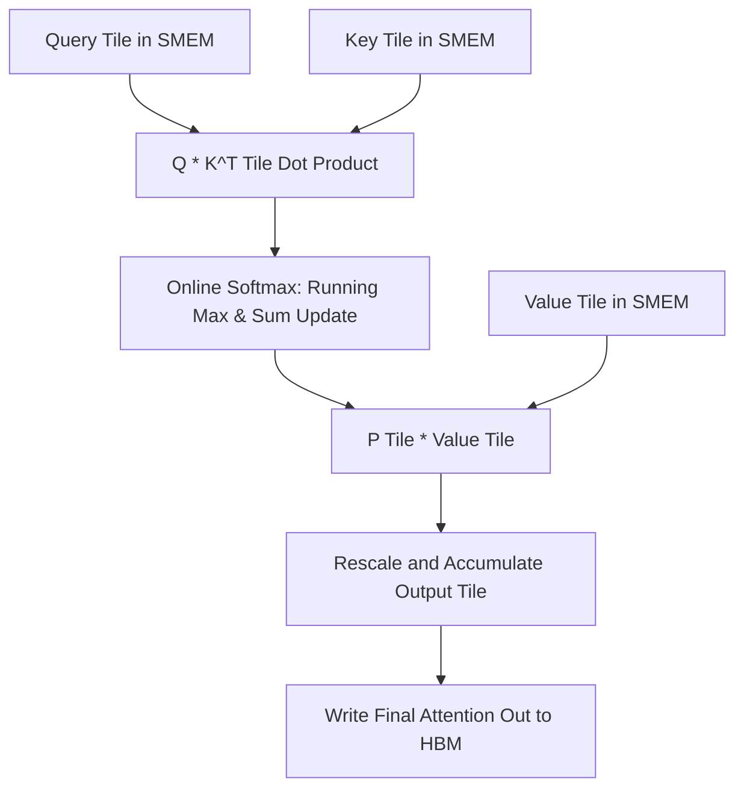

# Transformer Math for Kernel Engineers

**Target audience:** Senior GPU kernel engineers targeting LLM inference roles at NVIDIA, Modular, Cerebras.

**Prerequisites:** Expert CUDA, expert C++, understanding of memory hierarchy, roofline model, arithmetic intensity. You are building CuTe/CUTLASS kernels and FlashAttention prefill is your capstone project.

**What this is NOT:** This is not a deep learning tutorial. This does not teach training. This does not explain PyTorch or ML frameworks.

**What this IS:** The mathematical foundations of transformer inference at implementation depth. The math you need to write FlashAttention from scratch, implement KV cache correctly, understand why GQA exists, and answer systems-level interview questions.

---

## Learning Order

```
MUST read in order (foundation):
01_attention → 02_kv_cache → 05_flash_attention → 10_arithmetic_intensity

THEN in any order (extensions):
03_attention_variants → 04_positional_encoding → 06_quantization
07_paged_attention → 08_speculative_decoding → 09_mixture_of_experts
```

**Why this order:** Module 01 gives you the attention formula. Module 02 shows you why naive attention is impossible at inference time. Module 05 is the solution (FlashAttention). Module 10 teaches you to reason about whether any operation is compute-bound or memory-bound — this is what NVIDIA/Cerebras interviewers actually test.

---

## Directory Structure

```
transformer_math/
├── README.md                          ← this file
│
├── 01_attention/                      ← foundation: scaled dot-product attention
│   ├── README.md
│   ├── 01_scaled_dot_product.md       ← the core formula, shapes, why sqrt(d_k)
│   ├── 02_causal_masking.md           ← triangular mask, prefill vs decode
│   ├── 03_multi_head_attention.md     ← projections, shapes, FLOP count
│   ├── 04_flop_and_memory_analysis.md ← O(S²) derivation, bandwidth bound analysis
│   └── attention_forward.py           ← numpy implementation, shape assertions
│
├── 02_kv_cache/                       ← the memory wall
│   ├── README.md
│   ├── 01_why_kv_cache.md             ← redundancy in autoregressive decode
│   ├── 02_memory_formula.md           ← exact formula, worked examples
│   ├── 03_prefill_vs_decode.md        ← compute characteristics, BW-bound analysis
│   └── kv_cache_sim.py                ← simulate prefill + decode
│
├── 03_attention_variants/             ← MHA, MQA, GQA, MLA
│   ├── README.md
│   ├── 01_mqa.md
│   ├── 02_gqa.md
│   ├── 03_mla.md
│   └── attention_variants.py
│
├── 04_positional_encoding/            ← RoPE
│   ├── README.md
│   ├── 01_rope_math.md
│   ├── 02_rope_kernel_implications.md
│   └── rope.py
│
├── 05_flash_attention/                ← THE capstone module
│   ├── README.md
│   ├── 01_the_io_problem.md
│   ├── 02_tiling_insight.md
│   ├── 03_online_softmax.md           ← hardest math in this directory
│   ├── 04_fa2_improvements.md
│   └── flash_attention.py
│
├── 06_quantization/                   ← INT8, FP8, KV cache quantization
│   ├── README.md
│   ├── 01_why_quantize.md
│   ├── 02_int8_weight_quant.md
│   ├── 03_kv_cache_quantization.md
│   ├── 04_fp8_formats.md
│   └── quantization.py
│
├── 07_paged_attention/                ← vLLM's innovation
│   ├── README.md
│   ├── 01_memory_fragmentation.md
│   ├── 02_block_tables.md
│   ├── 03_kernel_implications.md
│   └── paged_attention_sim.py
│
├── 08_speculative_decoding/           ← draft-and-verify
│   ├── README.md
│   ├── 01_the_underutilization_problem.md
│   ├── 02_draft_and_verify.md
│   ├── 03_expected_tokens.md
│   ├── 04_tree_attention.md
│   └── speculative_decoding_sim.py
│
├── 09_mixture_of_experts/             ← MoE routing
│   ├── README.md
│   ├── 01_architecture.md
│   ├── 02_routing_math.md
│   ├── 03_inference_implications.md
│   └── moe_routing.py
│
└── 10_arithmetic_intensity/           ← systems thinking, roofline analysis
    ├── README.md
    ├── 01_roofline_for_attention.md
    ├── 02_decode_vs_prefill.md
    ├── 03_batch_size_effect.md
    └── intensity_calculator.py        ← most interview-relevant file
```

---

## How To Use This Directory

1. **Read the .md files in order** within each module. Do not skip the math derivations.

2. **Run every Python file** before moving to the next module. Each file prints `PASS` or `FAIL` at the end. If it prints `FAIL`, you do not understand the math yet.

3. **Answer the interview questions** in each .md file without looking at the answers. These are phrased exactly how NVIDIA/Cerebras interviewers ask them.

4. **When you reach Module 05 (FlashAttention)**, cross-reference the tile loop pseudocode against your CuTe FlashAttention kernel. They should map line for line.

5. **Module 10 is the most interview-relevant.** The arithmetic intensity calculator is what senior inference engineers actually use to reason about kernel design.

---

## Notation Convention

| Symbol | Meaning | Typical Value (LLaMA-3 8B) |
|--------|---------|---------------------------|
| B | Batch size | 1–128 |
| S | Sequence length | 4096 (max), 128–512 (decode) |
| H | Number of attention heads | 32 |
| d | Model dimension (hidden size) | 4096 |
| d_h | Head dimension (d / H) | 128 |
| L | Number of layers | 32 |
| V | Vocabulary size | 128256 |

**Subscripts:**
- q = query, k = key, v = value
- (l) = layer number (superscript)

**Tensor shapes always written explicitly.** No operation is described without shapes.

---

## Target Jobs This Material Prepares You For

1. **NVIDIA Senior DL Software Engineer (Inference)** — FlashAttention internals, KV cache, attention variants
2. **NVIDIA Senior DL Software Engineer (Inference & Model Optimization)** — quantization math, INT8/FP8 GEMM
3. **Modular Senior AI Kernel Engineer** — attention tiling math, arithmetic intensity analysis
4. **Cerebras LLM Inference Performance & Evals** — MoE routing, speculative decoding math, online softmax
5. **Cerebras Sr. Inference ML Runtime Engineer** — PagedAttention, continuous batching, serving math

---

## Before You Start

You should already understand:
- CUDA memory hierarchy (global, shared, register, L2 cache)
- Roofline model and arithmetic intensity
- Matrix multiplication tiling
- Why memory bandwidth is the bottleneck for most inference workloads

If you do not understand these, go back to your CuTe/CUTLASS materials first.

**Start with:** `01_attention/README.md`


---

## Educational & Memory Flow Architecture

### 1. Memory Hierarchy & Dataflow Architecture
```text
+---------------------------------------------------------------------------------+
| Global Memory: Full Attention Matrix Q, K, V ($O(N^2)$ memory wall avoided)      |
+---------------------------------------------------------------------------------+
        |  Block-Tiled Async Loading ($B_r \times d$, $B_c \times d$)           ^
        v                                                                         |
+---------------------------------------------------------------------------------+
| Shared Memory: SRAM Tile ($Q_i, K_j, V_j$) & Online Softmax Running Accumulators |
+---------------------------------------------------------------------------------+
        |  Online Softmax Rescaling in Registers                                 ^
        v                                                                         |
+---------------------------------------------------------------------------------+
| Output Register Accumulator $O_i$ ($O(N)$ SRAM IO Complexity)                   |
+---------------------------------------------------------------------------------+
```

### 2. Execution & Dataflow Graph


### 3. Transformer Mathematics & Hardware Efficiency Deep Dive
- **FlashAttention Online Softmax:**
  $$m_i = \max(m_{i-1}, \max(S_i)), \quad d_i = e^{m_{i-1} - m_i} d_{i-1} + \sum e^{S_i - m_i}$$
  $$O_i = \text{diag}(e^{m_{i-1} - m_i}) O_{i-1} + e^{S_i - m_i} V_i$$
- **Arithmetic Intensity & Roofline:**
  $$\text{Operational Intensity} = \frac{2 \cdot M \cdot N \cdot K}{M \cdot K + K \cdot N + M \cdot N} \approx \frac{2 K}{3}$$
- **PagedAttention & KV-Cache Footprint:**
  $$\text{KV Cache Memory per token} = 2 \times 2 \times n_{\text{layers}} \times n_{\text{heads}} \times d_{\text{head}} \times \text{sizeof}(\text{dtype})$$

### 4. Mathematical & Architectural Key Principles
- **Arithmetic Intensity & Roofline Model:** Bound kernel efficiency by maximizing FLOPS per byte transferred from higher-latency memory tiers:
  $$\text{Operational Intensity} = \frac{\text{Floating Point Operations (FLOPs)}}{\text{Bytes Transferred (DRAM \leftrightarrow SRAM)}}$$
- **Latency Hiding:** Software pipelines overlap asynchronous global loads with compute stages across unrolled loops.
- **Memory Coalescing & Bank Alignment:** Aligned memory accesses ensure full 32-byte or 128-byte transactions, preventing pipeline stalls.

---
